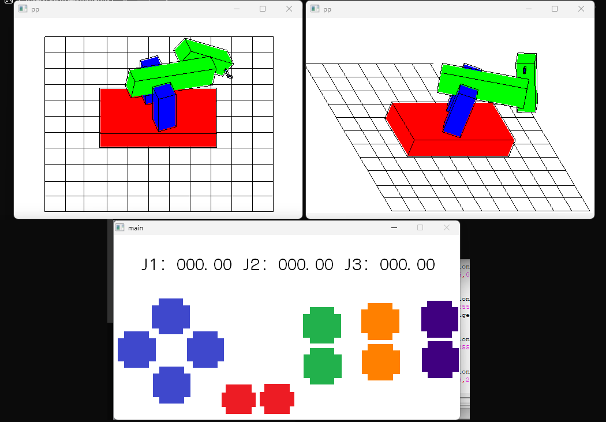

# 3-DOF Robotic Arm Simulation & Kinematic Control

An interactive 3D simulation and control environment for a **3-Degree-of-Freedom (3-DOF) Spatial Robotic Manipulator**. This project features a GUI controller built with **Allegro 4.2** and a real-time 3D renderer written in **C++ / OpenGL (freeglut & GLEW)** communicating via IPC datastream file buffers.



---

## 📑 System Architecture Overview

The system consists of two independent programs linked together via IPC text-buffer exchange (`conectando.dat`):

```
┌─────────────────────────┐   (j1, j2, j3, cam_x, cam_y)   ┌───────────────────────────┐
│ Allegro 4.2 Controller  │ ─────────────────────────────> │ OpenGL / freeglut 3D View │
│ (Direct & Inverse Kin)  │       "conectando.dat"        │ (Spatial Arm Visualization)│
└─────────────────────────┘                                └───────────────────────────┘
```

1. **`main_2.cpp` (Control Interface):** Built with Allegro 4.2. Handles forward/inverse kinematics equations (`Js2xyz.h`, `xyz2Js.h`), user mouse inputs, numerical display rendering, and data generation.
2. **`main2.cpp` (3D Visualizer):** Built with freeglut & OpenGL. Reads the joint output parameters and renders the 3-DOF robotic arm in real-time, complete with bounding wireframes and workspace ground plane.

---

## 🛠️ Prerequisites & Dependencies

To build and run this project, you will need a 32-bit GCC compiler (recommended for Allegro 4.2 compatibility):

* **IDE / Toolchain:** Code::Blocks 10.05 or 8.02 (bundled with MinGW GCC 3.4.5 / GCC 4.4)
* **GUI Library:** [Allegro 4.2.2 (MinGW Package)](https://sourceforge.net/projects/alleg/files/allegro-bin/4.2.2/)
* **OpenGL Libraries:**
  * [freeglut (MinGW Package)](https://www.transmissionzero.co.uk/software/freeglut-devel/)
  * [GLEW static build package](http://glew.sourceforge.net/)
* **Runtime DLLs:** `alleg42.dll` / `alld42.dll`, `freeglut.dll`, `msvcr70.dll`

---

## 📂 Project Structure

```
.
├── main_2.cpp              # Controller UI (Allegro 4.2)
├── main2.cpp               # 3D Visualizer (OpenGL + freeglut)
├── Js2xyz.h                # Direct Kinematics implementation header
├── xyz2Js.h                # Inverse Kinematics implementation header
├── kinematicExample.png    # Interface screenshot reference
├── assets/
│   ├── cursor.bmp          # Interface mouse cursor asset
│   ├── placa.bmp           # Control board background graphics
│   └── numeros.bmp         # Digital number font bitmap sheet
└── README.md
```

---

## ⚙️ Build and Installation Instructions

### Method 1: Using Code::Blocks 10.05 (Recommended)

1. Open **Code::Blocks** and create two separate Win32 GUI projects:
   * **Project 1:** `RobotController` using `main_2.cpp`
   * **Project 2:** `Robot3DRenderer` using `main2.cpp`
2. Configure Compiler Header Search Paths (`Search directories -> Compiler`):
   * Path to Allegro 4.2 `include/`
   * Path to freeglut `include/`
3. Configure Linker Library Search Paths (`Search directories -> Linker`):
   * Path to Allegro 4.2 `lib/`
   * Path to freeglut `lib/`
4. Add Linker Flags (`Build Options -> Linker Settings`):
   * **For Controller (`main_2.cpp`):**
     ```text
     -lalleg
     ```
   * **For Visualizer (`main2.cpp`):**
     ```text
     -lglew32 -lfreeglut -lopengl32 -lglu32 -lgdi32 -lwinmm
     ```
5. Build both executables (`.exe`).

### Method 2: Command Line Compilation (MinGW)

```bash
# Compile Controller
g++ main_2.cpp -o Controller.exe -I/path/to/allegro/include -L/path/to/allegro/lib -lalleg

# Compile 3D Visualizer
g++ main2.cpp -o Visualizer.exe -lglew32 -lfreeglut -lopengl32 -lglu32 -lgdi32 -lwinmm
```

---

## 🚀 Running the Project

1. Copy required bitmap assets (`cursor.bmp`, `placa.bmp`, `numeros.bmp`) and dynamic libraries (`freeglut.dll`, `alld42.dll`) into your working directory.
2. Launch `Controller.exe` first to initialize UI controls.
3. Launch `Visualizer.exe` to start the 3D viewport.

### Controls & Navigation

* **Controller UI:**
  * Toggle between **Joint Mode (J1, J2, J3)** and **Cartesian Mode (X, Y, Z)** via interface buttons.
  * Adjust speed multipliers or manipulate joint angles using the on-screen tactile directional arrows.
* **Keyboard Hotkeys (3D Viewport):**
  * `1` / `4`: Rotate Base Joint ($j_1$) $\pm 10^\circ$
  * `2` / `5`: Rotate Shoulder Joint ($j_2$) $\pm 10^\circ$
  * `3` / `6`: Rotate Elbow Joint ($j_3$) $\pm 10^\circ$
  * `7` / `9`: Adjust Camera Deviation / Altitude
  * `8`: Reset Camera Viewpoint to Origin
